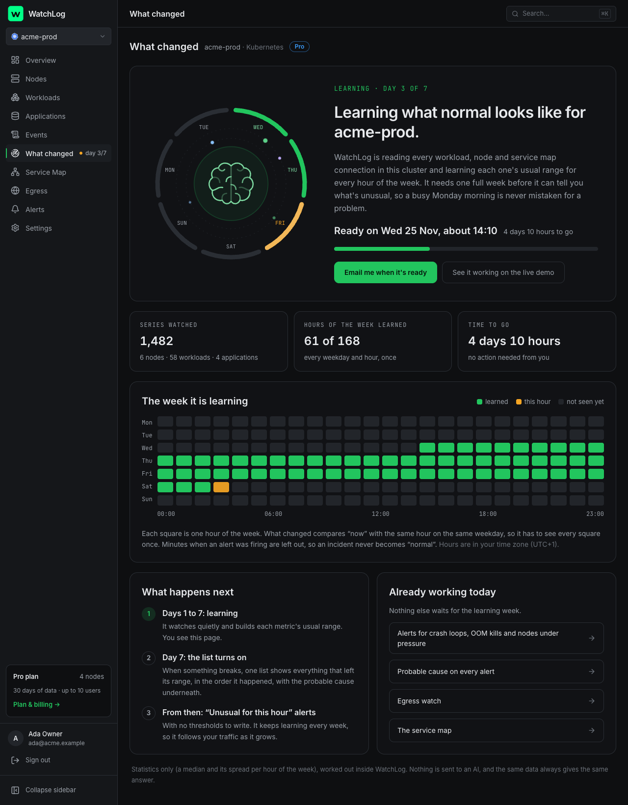

# What changed

When something breaks, the first question is what changed. What changed answers it for a
Kubernetes cluster and for a Server fleet: each metric WatchLog scores learns its own usual
week, and when something breaks, one list shows everything that left its usual range, in the
order it happened, with the [probable cause](probable-cause.md) underneath. Anomaly alerts fire
on "unusual for a Tuesday at 14:00 UTC", with no threshold to write.

It is statistics only, worked out inside WatchLog: a median and a spread for each hour of the
week. Nothing is sent to an AI, and the same data always gives the same answer.

**What changed is part of Pro** in [WatchLog Cloud](cloud.md). Cloud Free and the self-hosted
Community edition see an upgrade page in its place (below); everything else stays free on every
plan, including alerts, the service map, probable cause and [Egress watch](egress.md).

## How the usual range is learned

For each series (a metric of one workload, node, container, host, service map connection or
application), WatchLog keeps a **baseline for each of the 168 hours of the week** (UTC): the
median and the median absolute deviation (MAD) of its one-minute values over the **last 14
days**. A bucket holds the same hour of two weeks, one after 7 days.

- **How unusual:** `score = |value − median| / spread`, where the spread is
  `1.4826 × MAD`, but never less than a floor for the kind of value, so a flat series doesn't
  turn every wobble into an anomaly. The floors are the larger of 5 % of the median and: 0.05
  cores, 32 MiB, 0.02 for ratios, 100 KiB/s, 0.5 a second for rates, 50 ms, and 2 for counts.
  So a series has to move at least about 0.2 cores, 128 MiB, 8 percentage points, 400 KiB/s, 2
  requests a second, 200 ms or 8 before it can be unusual.
- **The usual range** shown on the page, in alerts and in the API is `median ± 2 × spread`
  for that hour (never below 0 for values that can't be negative). A value inside it scores 2
  or less.
- **Incidents aren't learned as normal.** A minute is left out of a series' baseline while
  another alert was firing on its subject: from the moment the alert's condition first held
  until it resolved. On Kubernetes that is the workload (a pod's alert counts for its
  workload) or the node; on Docker the container, its Compose service or the host; for an
  application, the monitored service. A failed connection's destination is left out too.
  Anomaly alerts' own minutes stay in, so a lasting change becomes the new usual within two
  weeks instead of alerting for good.

### The 10-minute rule

Something is **unusual** when its score stays above **4 for 10 minutes in a row**. It ends
after 10 minutes at 4 or less (or 10 minutes after the series stops reporting). One odd minute
is never listed: only a change that lasts.

### The metrics it scores

The curated metrics of WatchLog's catalog, per object, never raw queries:

| Kubernetes                                                                    | Servers                                                                                        |
| ----------------------------------------------------------------------------- | ---------------------------------------------------------------------------------------------- |
| Workloads: CPU, memory, and the requests, errors and p95 response time served | Services and process groups: CPU and memory                                                    |
|                                                                               | Containers: CPU, memory, network, and the requests, errors and p95 response time served        |
| Nodes: CPU, memory, network and disk I/O                                      | Servers: CPU, memory, network and disk I/O                                                     |
| Service map connections: connections, requests and p95 between workloads      | Service map connections between containers, the destination named as its Compose service       |
| Monitored applications: rates, ratios, latency, connections, lag, queue depth | The same for applications on the servers (Redis, PostgreSQL, MySQL, MongoDB, Nginx, and so on) |

Left out on purpose: pods (they come and go; their workload carries them), restarts, OOM kills,
throttling and node conditions (default alert rules already cover them as events), and
up/down, certificate or size metrics. On a server a container is followed by its name, which a
Compose re-create keeps, and shown with its Compose project and service.

## The learning period

A series is used once it has **7 days** of its own data: every hour of the week learned
once. Until then, What changed is "learning":

- **Learning starts when your organization gets Pro:** at the 0.8.0 update for organizations
  already on Pro, or the minute you upgrade. The baselines read only the data from then on,
  never the history before it.
- **Nothing is listed for the first 7 days,** and no anomaly alert fires. After that, each
  series with 7 days of data is used; a cluster, workload, server or container added later
  starts learning when it first reports.
- **7 days of data, not 7 days on the calendar.** An hour in which your organization was not
  on Pro, or your agents sent nothing, is not learned. The list turns on when that hour of the
  week has come round and been learned, so a week with a two-day gap takes nine days. Without
  a gap it is exactly 7 days. (An hour that never has data, such as a fleet switched off every
  night, is settled after the second week.)
- **After 14 days** each hour of the week has two weeks behind it.
- **A downgrade** stops the scoring at once. The baselines are kept for 30 days, so upgrading
  again within that time picks up where it stopped: what was learned before still counts, only
  the hours in between are still to learn, and the page says "Learning resumed on <date>". A
  cluster that had finished learning lists again at once. After 30 days learning starts over.

### What the first week looks like

For those 7 days the page shows the learning week instead of the list:



- **Which day it is and when it is ready:** "Learning · day 3 of 7" and "Ready on Wed 25 Nov,
  about 14:10", in your own time zone, with the time to go. The day counts the hours really
  learned (one day for every 24), and the date is when WatchLog will start listing by the
  same rule it scores with, so the ring, the bar and the grid below always agree.
- **What it is reading:** the number of series, and what they are in your platform's words
  (nodes, workloads and applications; or servers, services, process groups, containers and
  applications).
- **The week it is learning:** one square for each of the week's 168 hours: learned, this
  hour, or not seen yet. What changed compares "now" with the same hour on the same weekday,
  so it needs to see every square once. An hour in which your agents sent nothing stays empty,
  and so does one in which an alert was firing on everything.
- **Email me when it's ready:** one email to your own address the minute the list turns on,
  for that cluster or fleet. Every member can ask, Viewers too, and pressing the button again
  undoes it. Nothing is sent if the organization has left Pro by then.
- **What already works:** alerts, probable cause, Egress watch and the service map don't wait
  for the learning week.

Elsewhere the same is said in small: an alert's "What changed around it" card is one line with
the ready date, and the navigation shows "day 3/7" beside What changed.

Later, when the list is on and a server or workload that joined afterwards is still inside its
own 7 days, a line above the list says how many series are still learning and when the last is
ready.

On Cloud Free the page shows the same picture waiting, labelled "Not learning yet": nothing is
learned on Free, and the date on it is when What changed would be ready if you upgraded today.

**The live demo is the exception.** It learns from the 7 days of history it keeps when it
starts, so its page lists changes right away. It also has a scenario of its own for What
changed: every 2 hours, at 50 minutes past every odd hour UTC (01:50, 03:50, … 23:50), `search`'s
response time drifts from about 10 ms to a second over 20 minutes and back, on the demo cluster
and on its Server fleet. [Open the live demo](https://demo.watchlog.io/demo) and choose **What
changed** with the **Last 6 hours** window.

## The What changed page

**What changed** is in the navigation of every cluster and fleet, after Events.

- **Windows:** around an alert (from an hour before it started to 15 minutes after it, or
  now), the last hour, the last 6 hours, or a custom range of up to 24 hours.
- **The unusual-activity chart:** how many series were unusual each minute, with the window
  marked.
- **The rows:** when it started, what, and usual → now: the usual range for that hour, then
  the latest value while it lasts or the furthest one once it ended, with a bar for how far out
  it went. Order them by **First to move** (the default) or **Furthest out**. At most 50 rows,
  then "and N more". Each row links to its object.
- **The probable cause** underneath: the same answer as on the alert's page, for the alert in
  alert mode, or for the first row that is a workload or a container. "Open the evidence",
  "Copy as text" and "Ask your AI" work as everywhere.

Each platform is shown in its own words:

- **Kubernetes:** `checkout (shop) · p95 response time`, `node-3 · memory`,
  `reports-worker · connections to postgres`.
- **Docker:** `storefront-checkout-1 · p95 response time`, shown with its Compose project and
  service (`storefront · checkout`), and `docker-01 · memory` for a host.

The list is ordered by time and nothing more: no rule decides that one change caused another.
The cause underneath is probable cause's own answer, from its fixed rules.

### On every alert

Every alert's page has a **What changed around it** card: the first three rows around the
alert and a link to the page in alert mode. On Cloud Free the card is one locked line that
opens the upgrade page; a Community install shows no card.

## Anomaly alerts

Pro organizations get one more default rule, **Unusual for this hour** (`anomaly.unusual`),
severity warning. It can be turned off, and its severity and channels changed, like any default
rule; the score of 4 and the 10 minutes aren't editable in 0.8.0.

- **One alert per subject and metric,** opened when a period has been unusual for 10 minutes,
  resolved when it ends. Silences, reminders and held clusters work as for every rule.
- **Quiet after a change:** no anomaly alert opens on a subject within **30 minutes** of a
  change to it. On Kubernetes that is a rollout or image change of its workload; on Docker a
  re-created container, an image change or a Compose change of its service or project. If it
  is still unusual when the quiet ends, the alert opens then, and the change is usually its
  likely cause. The page lists the period all along.
- **No second alert for the same incident:** while another alert is firing on the same
  subject (its workload, container, Compose service or monitored service), no anomaly alert
  opens for it. The period is still listed, on the page and in the other alert's card, and the
  anomaly alert opens if the period outlasts the other alert.
- **Service map connections don't alert by default;** their change shows on the destination's
  own metrics, which do. They are still listed.

### What a message says

```text
🟠 WARNING · checkout (shop): p95 response time unusual for a Tuesday at 14:00 UTC

usual for Tuesday 14:00 UTC: 120–180 ms; now 2.4 s
shop/checkout (Deployment) · cluster acme-prod · since 14:00 UTC (12 min)
Likely cause: Connections are at 97% of max_connections (97 of 100). Most are held by reports-worker.
https://watchlog.example.com/alerts/…
```

A Docker message names the container and its host (`docker-01/storefront-checkout-1`), with
the Compose project and service in the details. The `Likely cause:` line comes only when
probable cause finds one ([alerts](alerts.md#the-likely-cause)). Slack, Telegram, email and the
webhook get the same words; messages say UTC, the dashboard your own time zone.

The alert's page shows the series against its usual band for each hour of the day, the What
changed around it, and the probable cause.

### "Was this worth an alert?"

Under an anomaly alert, Owners and Admins answer:

- **Yes, keep alerting:** kept, so this kind of change keeps alerting.
- **No, this is normal for us:** widens that series' usual range for that hour of the week, so
  the value it reached scores 4 or less there, and ends the alert. A larger change still
  alerts. The series then says "Widened on <date> by <name>".

Every answer is audited and can be undone. Viewers see the answer, not the buttons.

## The upgrade page (Cloud Free and Community)

On Cloud Free and on a self-hosted Community install, **What changed** opens an upgrade page:
an example from the live demo, labelled as such, your own last alerts each marked "What
changed: Pro", the three reasons, and the price ($3 per node a month, $15 minimum, billed on
the 95th percentile of your hourly nodes). On Cloud Free an Owner upgrades from there; Admins
and Viewers see who the Owners are. A Community install links to WatchLog Cloud's sign-up and
sends nothing anywhere: your install keeps everything it has, with no limits.

## API and MCP

- **REST:** `GET /api/v1/what-changed?cluster=…&alert=…` or `…&from=…&to=…` (Unix seconds, at
  most 24 hours), `sort=first|furthest`: at most 50 rows with the learning state (`learning`: whether it is
  learning, `since`, `until`, `day`, `hoursLearned` of 168, the `week` as 168 characters and
  the `series`) and the
  probable cause's short form. API tokens with the read scope can call it. See
  [API](api.md#for-both-kinds).
- **MCP:** `get_what_changed` with the same arguments, at most 30 rows and 16 KB, each row in
  its platform's words. Names and labels come back as data. See [MCP](mcp.md).

On Cloud Free the route answers `403` with `urn:watchlog:problem:pro-feature` and the tool says
What changed is part of Pro; on a Community install the route answers `404` and the tool isn't
listed. The anomaly alert's page and "Was this worth an alert?" need a browser session.

## Configuration

Nothing to set: the anomaly-worker runs in WatchLog Cloud, and agents send nothing new.

- **`anomalyWorker.enabled`** (Helm chart `watchlog`, default `false`; requests 50m and 128Mi,
  memory limit 512Mi): the separate process that learns the baselines and records unusual
  periods. It runs only in Cloud mode or with `demoMode` (the live demo), and exits at start
  anywhere else, so a self-hosted install needs nothing here. See
  [Configuration](configuration.md).
- **`WATCHLOG_ANOMALY_ALERT_KEYS`** (the alert worker, Cloud mode): which metrics may raise an
  anomaly alert, as a comma-separated list with `*` as a wildcard and `!` to leave out. The
  default is `*,!edge.*`: everything but the service map's connections. The page lists every scored
  metric either way.

## Limits

- **Pro only,** in WatchLog Cloud (and the live demo). No self-hosted install runs it.
- **Not correlation:** the list is ordered by time; it doesn't link anomalies to each other.
- **10 minutes:** a change shorter than 10 minutes past a score of 4 isn't listed.
- **UTC hours:** a daylight-saving change moves a local pattern by an hour for up to two
  weeks.
- **Windows** are at most 24 hours; the page keeps unusual periods for your plan's history.
